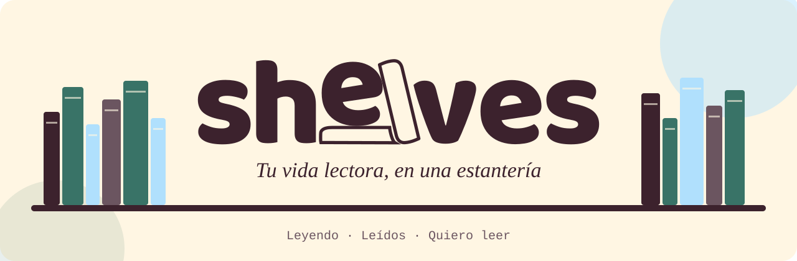
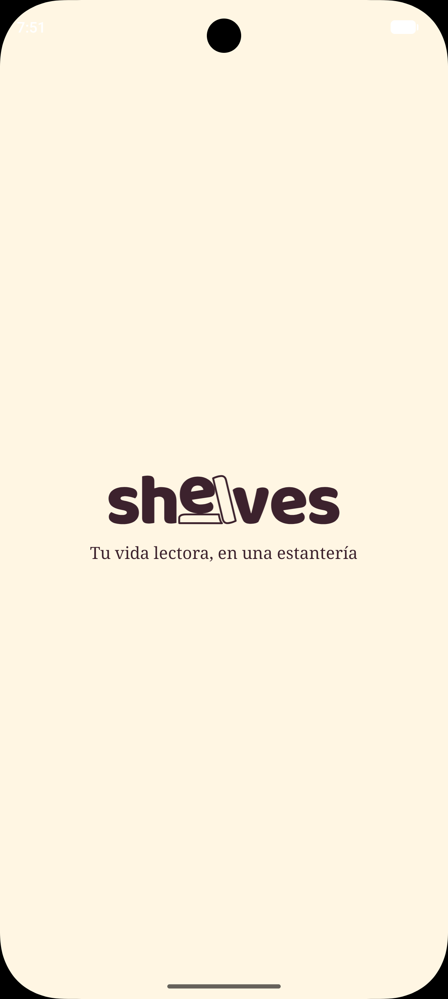
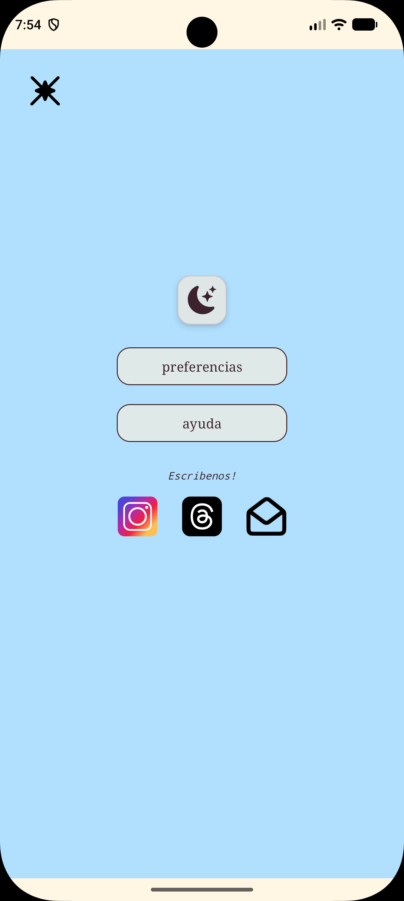
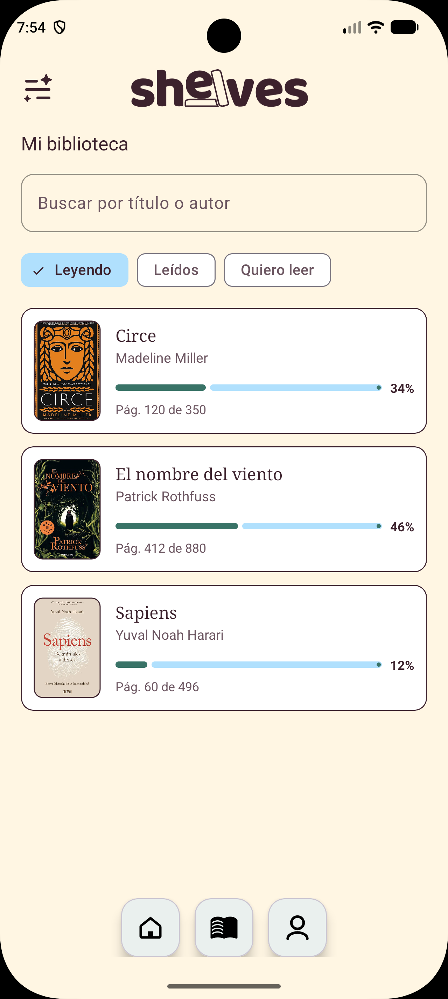
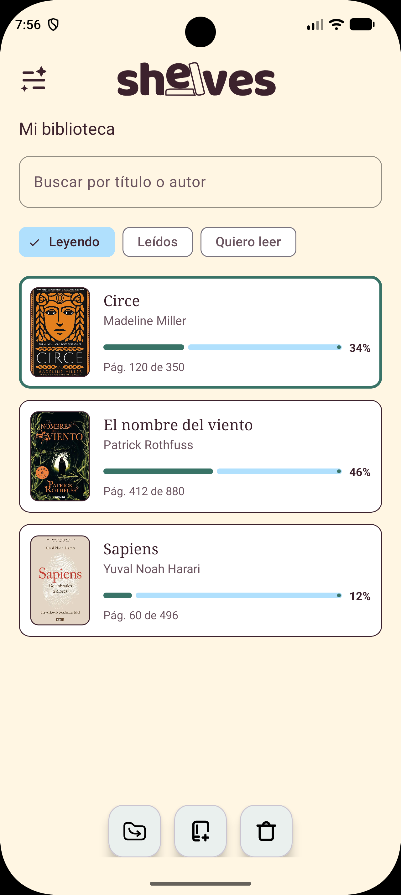
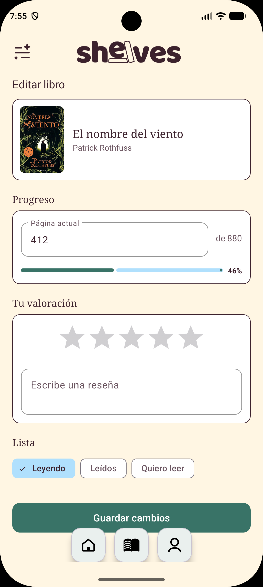
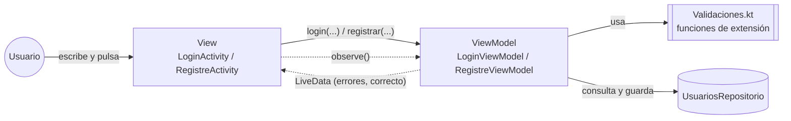
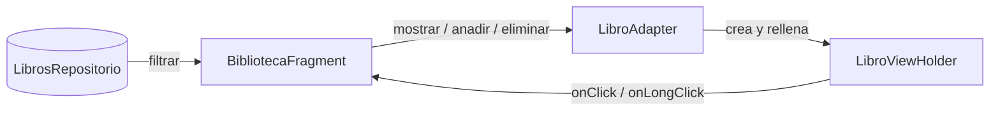

<p align="center">
  
</p>

<p align="center">
  
  
  
  
  
  
</p>

# Shelves 📚

**Shelves** es una aplicación Android para llevar el registro de todos los libros que lees. Es una especie de *Letterboxd*, pero para libros: puedes apuntar lo que estás leyendo, lo que ya has terminado y lo que quieres leer, valorarlo y escribir una reseña.

Tiene una parte social sencilla y sin ruido: solo te puede seguir quien conoce tu nombre de usuario, y no hay muro ni publicaciones.

## 👩‍💻 Autoras

| | |
|---|--|
| **Adriana Vallespí** |
| **Fernanda Arias** |

Proyecto del ciclo de **Desarrollo de Aplicaciones Multiplataforma (DAM)** del Institut TIC de Barcelona.

## 📌 Estado del proyecto

| Actividad | Contenido | Estado |
|---|---|---|
| 04 | Prototipo de baja fidelidad | ✅ |
| 05 | Interfaz del prototipo en XML | ✅ |
| 06 | Menús, navegación y listas dinámicas | ✅ |
| **07.1** | **ViewModel y observabilidad (MVVM)** | ✅ **Esta versión** |

En la Actividad 06 la app ya funcionaba: pantalla de inicio animada, navegación entre todas las pantallas, un menú propio y dos listas dinámicas con eventos.

En esta versión hemos **reorganizado el Login y el Registro con el patrón MVVM**. Ahora cada pantalla tiene un **ViewModel** que valida los datos y avisa a la Activity mediante **LiveData**. También hay un **repositorio de usuarios**, así que el Registro guarda la cuenta y el Login comprueba que exista. Lo explicamos en la sección **🏛️ Arquitectura MVVM**.

🎥 **Vídeo de la práctica:** [ver en YouTube](ENLACE_DEL_VIDEO)

---

## 📱 Capturas

<table>
  <tr>
    <td align="center"><br><b>Splash</b></td>
    <td align="center"><br><b>Login</b></td>
    <td align="center"><br><b>Inicio</b></td>
    <td align="center"><br><b>Menú</b></td>
  </tr>
  <tr>
    <td align="center"><br><b>Biblioteca</b></td>
    <td align="center"><br><b>Barra de edición</b></td>
    <td align="center"><br><b>Editar libro</b></td>
    <td align="center"><br><b>Modo oscuro</b></td>
  </tr>
</table>

---

## 🧭 Navegación


La app tiene **una activity contenedora** (`MainActivity`) y casi todas las pantallas son **fragments** que se cargan dentro de ella. Solo son activities aparte el Splash, el Login y el Registro, porque se ven antes de entrar en la app.

### 🎬 Pantalla inicial (Splash)

`SplashActivity` es la primera pantalla que se abre (en el manifest es la activity `LAUNCHER`).

- El logo entra con una animación de **fundido y escala con un pequeño rebote** (`res/anim/splash_logo.xml`, con `overshoot_interpolator`).
- Cuando acaba, aparece el lema *"Tu vida lectora, en una estantería"* y, después de un momento, se abre el Login.
- Cuando se abre el Login, se llama a `finish()`, para que al pulsar "atrás" no se vuelva a ver el splash.
- Si en el móvil están **desactivadas las animaciones**, se salta la animación y se pasa directamente al Login.

### 🔐 Login y Registro

- Los datos de cada campo se validan (que no estén vacíos y que tengan el formato correcto). Si algo falla, se marca con un **error en rojo** en el propio campo.
- El Registro guarda el usuario nuevo y el Login comprueba que la cuenta exista.
- Al entrar en la app se borran el Login y el Registro de la pila de pantallas, así el botón "atrás" cierra la app en vez de volver al formulario.

Desde la Actividad 07.1 estas dos pantallas siguen el patrón **MVVM**. Se explica con detalle en la sección siguiente.

---

## 🏛️ Arquitectura MVVM (Actividad 07.1)

### ¿Qué es MVVM?

MVVM (*Model – View – ViewModel*) es una forma de organizar el código de una pantalla en tres partes, cada una con una sola responsabilidad:

| Capa | Qué hace | En Shelves |
|---|---|---|
| **Model** | Los datos y dónde se guardan | `Usuario`, `UsuariosRepositorio` |
| **View** | Lo que ve el usuario. Muestra datos y recoge clics, pero no decide nada | `LoginActivity`, `RegistreActivity` |
| **ViewModel** | La lógica de la pantalla. Recibe lo que escribe el usuario, lo valida, habla con el repositorio y publica el resultado | `LoginViewModel`, `RegistreViewModel` |

Antes de esta práctica, las Activities hacían todo: leían los campos, comprobaban si estaban vacíos y decidían si se podía entrar. Ahora la Activity solo hace dos cosas: **pasar el texto al ViewModel** y **mostrar lo que el ViewModel le dice**.



Las flechas continuas son llamadas directas y las discontinuas son la **observación**: el ViewModel no conoce a la Activity ni le da órdenes. Solo cambia el valor de sus LiveData, y la Activity, que está "escuchando", reacciona.

### ViewModel

Un `ViewModel` es una clase que guarda el estado y la lógica de una pantalla. Lo más importante es que **sobrevive a los cambios de configuración**. Cuando se gira el móvil, Android destruye la Activity y la vuelve a crear, pero el ViewModel no se destruye. Por eso, si hay un error en un campo y se gira el móvil, el error sigue ahí.

En la Activity lo obtenemos así:

```kotlin
private val viewModel: LoginViewModel by viewModels()
```

`by viewModels()` crea el ViewModel la primera vez y, si la Activity se recrea, devuelve el mismo objeto en vez de uno nuevo.

El ViewModel **nunca usa `Context`** (ni `getString`, ni vistas). Así no depende de la Activity y no hay riesgo de que se quede con una referencia a una pantalla que ya no existe.

### LiveData y observabilidad

`LiveData` es un contenedor de un valor que **avisa a quien lo observa cada vez que cambia**. Además, tiene en cuenta el ciclo de vida: solo avisa a la Activity cuando está visible, y deja de avisar sola cuando se destruye, así que no hay que desuscribirse a mano.

En cada ViewModel usamos siempre la misma estructura:

```kotlin
private val _errorUsuario = MutableLiveData<Int?>()   // privado: solo el ViewModel lo cambia
val errorUsuario: LiveData<Int?> = _errorUsuario      // público: la Activity solo puede leerlo
```

- `MutableLiveData` se puede modificar. Lo dejamos **privado** para que solo el ViewModel pueda cambiar el estado.
- `LiveData` es de solo lectura. Es lo que ve la Activity.

En la Activity nos suscribimos con `observe()`:

```kotlin
viewModel.errorUsuario.observe(this) { error ->
    etUsuario.error = error?.let { getString(it) }
}
```

**Qué guardan nuestros LiveData:**

| LiveData | Tipo | Significado |
|---|---|---|
| `errorUsuario`, `errorContrasena`… (uno por campo) | `Int?` | El id del texto de error (`R.string.error_...`), o `null` si el campo está bien. Guardamos el id y no el texto porque el ViewModel no debe usar `Context`; la Activity convierte el id en texto con `getString()` |
| `loginCorrecto` / `registroCorrecto` | `Boolean` | Pasa a `true` cuando todo es correcto. La Activity lo observa y abre `MainActivity` |

La navegación también se hace **dentro del observer**, no en el clic del botón: el botón solo avisa al ViewModel, y es el ViewModel quien decide si se puede entrar.

### Repositorio de usuarios (Model)

`UsuariosRepositorio` es **el único sitio de la app que guarda y consulta usuarios**. Los ViewModels no saben dónde están los datos; solo llaman a sus funciones:

| Función | Qué hace |
|---|---|
| `existeUsuario(nombre)` | Dice si ese nombre de usuario ya está registrado |
| `registrar(usuario)` | Guarda un usuario nuevo |
| `comprobarLogin(nombre, contraseña)` | Dice si el usuario y la contraseña corresponden a una cuenta |

De momento los usuarios se guardan en una **lista en memoria**, así que se borran al cerrar la app. Más adelante la cambiaremos por una base de datos o una API, y solo habrá que modificar el repositorio: los ViewModels y las Activities seguirán igual. Es un `object`, así que el Login y el Registro comparten los mismos datos y no hace falta una Factory para pasárselo al ViewModel.

Para probar el login sin registrarse hay un usuario precargado: **`demo` / `shelves2026`**.

### Funciones de extensión (`Validaciones.kt`)

Las reglas de validación están en funciones de extensión de `String`. Una función de extensión añade un método a una clase que no es nuestra sin modificarla, así que se puede escribir `email.esEmailValido()` como si fuera una función propia de `String`. Las usan los dos ViewModels, y por eso el Login y el Registro validan exactamente igual.

| Función | Regla |
|---|---|
| `esUsuarioValido()` | De 3 a 20 caracteres: letras, números, `.` o `_` |
| `esNombreValido()` | Letras (también con tildes), espacios, `'` o `-`; de 2 a 40 caracteres |
| `esEmailValido()` | Formato de email (`algo@dominio.ext`) |
| `esPasswordValida()` | Mínimo 8 caracteres, con al menos una letra y un número |

### Validaciones de cada pantalla

Cada campo se comprueba en este orden: **primero que no esté vacío y después el formato**. Así el usuario recibe el mensaje más útil en cada momento.

**Login**

| Campo | Comprobaciones |
|---|---|
| Usuario | Obligatorio → formato de usuario |
| Contraseña | Obligatoria → formato de contraseña → que la cuenta exista en el repositorio (*"Usuario o contraseña incorrectos"*) |

**Registro**

| Campo | Comprobaciones |
|---|---|
| Usuario | Obligatorio → formato de usuario → que no exista ya (*"Este nombre de usuario ya existe"*) |
| Nombre / Apellido | Obligatorio → formato de nombre |
| Email | Obligatorio → formato de email |
| Contraseña | Obligatoria → formato de contraseña |
| Confirmar contraseña | Obligatoria → que sea igual que la contraseña |

Si todo es correcto, el Registro guarda el usuario en el repositorio y entra en la app.

### Documentación del código

Las clases ViewModel, cada LiveData, el repositorio y las funciones de validación están comentados en formato **JavaDoc/KDoc** (`/** ... */`, con `@param`, `@return` y `@see`). Explican para qué sirve cada parte y por qué está hecha así.

### ⬇️ Barra inferior

Tiene tres pestañas: **Inicio · Biblioteca · Perfil**. Al pulsar una, `MainActivity` sustituye el fragment del contenedor central (`replace`) con un fundido, y cambia el icono de la pestaña por su versión rellena (`*_active`).

### ☰ Menú hamburguesa

**No es un Navigation Drawer.** Es un fragment propio (`MenuFragment`) que aparece encima de toda la pantalla, siguiendo el diseño del prototipo:

1. Al pulsar ☰, `MainActivity` añade `MenuFragment` a `overlay_container` (un contenedor que está por encima de todo) con una animación que lo desliza desde la izquierda.
2. La transacción se guarda en el **back stack**, por eso el menú se cierra tanto con su botón como con el "atrás" del móvil.
3. Desde el menú se puede:
   - Abrir **Preferencias** o **Ayuda**. Se cierra el menú y la sección se abre en el contenedor central; con "atrás" se vuelve a la pestaña en la que estabas.
   - Cambiar entre **modo claro y oscuro**.
   - Pulsar los enlaces de **contacto** (Instagram, Threads y email). De momento solo muestran un aviso.

**Funciones de `MainActivity` que controlan la navegación:**

| Función | Qué hace |
|---|---|
| `navegarA(boton, fragment)` | Cambia de pestaña y marca el icono activo |
| `abrirMenu()` / `cerrarMenu()` | Muestra u oculta el menú con su animación |
| `abrirSeccion(fragment)` | Cierra el menú y abre Preferencias, Ayuda o Editar libro, guardándolo en el back stack |
| `mostrarBarraNavegacion(visible)` | Oculta la barra inferior mientras se ve la barra de edición de la Biblioteca |

---

## 📋 Listas dinámicas (RecyclerView)

La app tiene **dos listas dinámicas** con su propio diseño de fila.

### 1. Biblioteca (lista vertical)



| Clase | Para qué sirve |
|---|---|
| `Libro` | `data class` con los datos de un libro: título, autor, páginas, lista, valoración, reseña y portada. El porcentaje leído se calcula a partir de las páginas |
| `ListaLibro` | `enum` con las tres listas: *Leyendo*, *Leídos* y *Quiero leer* |
| `LibrosRepositorio` | `object` con los libros de prueba. Al ser un `object`, toda la app comparte los mismos datos |
| `LibroViewHolder` | Guarda las vistas de una fila (`item_libro.xml`), para no buscarlas cada vez que se reutiliza al hacer scroll. Su función `bind()` pone los datos del libro y le asigna los eventos |
| `LibroAdapter` | Conecta la lista de libros con el RecyclerView: `onCreateViewHolder` crea las filas, `onBindViewHolder` las rellena y `getItemCount` dice cuántas hay. Los clics no se programan aquí, se reciben como funciones (*lambdas*), así la lógica queda en el fragment |

**Eventos de la lista:**

| Gesto | Evento | Qué pasa |
|---|---|---|
| Tocar un libro | ✏️ **Modificar** | Se abre *Editar libro* (página actual, valoración, reseña y lista). Al guardar, el libro se actualiza |
| Mantener pulsado | Seleccionar | El libro se marca con un borde verde y la barra inferior se cambia por la **barra de edición** |
| ➕ en la barra | **Añadir** | Diálogo con título, autor y páginas. El libro aparece al final con animación (`notifyItemInserted`) |
| ↔️ en la barra | **Modificar** (mover) | Diálogo para cambiar de lista. El libro desaparece de la lista actual (`notifyItemRemoved`) |
| 🗑️ en la barra | **Eliminar** | Se pide confirmación y se borra el libro (`notifyItemRemoved`) |

Todos los eventos escriben un **Log** (con el tag `Biblioteca`) y muestran un **Toast**. Además, la lista se puede filtrar con los **chips** de cada lista y con el **buscador** (por título o autor).

### 2. Libros más leídos del mes (lista horizontal, en Inicio)

Es un carrusel de portadas que se filtra por género con los chips (*General, Terror, Romance, Fantasía, Distopía*). Al tocar una portada sale un Toast con el título y el autor.

| Clase | Para qué sirve |
|---|---|
| `LibroTop` / `Genero` | Modelo de cada libro del ranking y sus géneros |
| `TopLibros` | `object` con los datos de prueba y la función `porGenero()` |
| `PortadaViewHolder` | Guarda la portada y el título de `item_portada.xml` |
| `PortadaAdapter` | Rellena el carrusel y cambia los libros al elegir otro género |

---

## ♿ Accesibilidad y usabilidad

### Nuevo en la Actividad 06

| Acción | Por qué |
|---|---|
| El splash se salta la animación si están desactivadas en el sistema | Hay personas a las que el movimiento les molesta o marea |
| Botón de menú ampliado de 32dp a **48dp** de zona táctil (el icono se sigue viendo igual) | Es el tamaño mínimo recomendado para poder tocarlo bien |
| La pestaña activa se marca con `isSelected` | TalkBack dice "seleccionado" en la pestaña actual |
| Cada fila de la lista tiene una sola descripción: *"Circe, de Madeline Miller. Leído un 34%"* | TalkBack lee la fila entera de una vez, en vez de cada texto por separado |
| Los gestos de las filas tienen nombre para TalkBack: *"Editar"* y *"Seleccionar"* | El usuario sabe qué pasará antes de tocar |
| El libro seleccionado se marca con un **borde más grueso**, no solo con otro color | Se distingue aunque no se vean bien los colores |
| El botón "atrás" cierra primero el menú y quita la selección | Se comporta como el usuario espera |
| **Confirmación** antes de eliminar un libro | Evita borrar por error |
| Errores de los formularios en el propio campo | Se ve enseguida qué falta |
| `contentDescription` en las tarjetas clicables del menú, e iconos decorativos con `importantForAccessibility="no"` | Que TalkBack no lea dos veces lo mismo |
| Inspect Code sin avisos de accesibilidad | Revisión final |

### De la Actividad 05

- Zonas táctiles de **48dp como mínimo** en botones y controles.
- `contentDescription` en todos los elementos interactivos.
- Títulos marcados como **encabezados** (`accessibilityHeading`).
- Colores de texto con **contraste suficiente**, también en modo oscuro.
- Teclados adecuados según el campo (numérico, texto multilínea…).

---

## 🎨 Diseño

### Prototipo en Figma

El diseño visual de la app es de **Adriana Vallespí**, que lo hizo en Figma a partir del prototipo de baja fidelidad de la Actividad 04.

🎨 **[Ver el diseño de Shelves en Figma](https://www.figma.com/design/OnKBkMrcMR1xTcMjwMCeNa/shelves?node-id=0-1&p=f)**

### Paleta

| | Color | Uso |
|---|---|---|
|  | **Midnight violet** `#3C222D` | Texto y bordes |
|  | **Verde** `#397367` | Color principal: botones, progreso y selección |
|  | **Icy blue** `#B0E0FD` | Acentos y fondo del menú |
|  | **Crema** `#FFF6E3` | Fondo |

### Recursos

- **Tema propio** basado en Material 3 (`Theme.Shelves`), con **modo claro y oscuro** (`values/colors.xml` y `values-night/colors.xml`).
- **Estilos reutilizables** en `styles.xml`: tarjetas con borde, botones, campos de texto y títulos en serif.
- **Animaciones** en `res/anim`: entrada del splash, y entrada y salida del menú.
- **Drawables** propios: iconos vectoriales, logo y portadas de los libros de prueba.
- **Textos** separados en un archivo de strings por pantalla.

---

## 🗂️ Estructura del código

```
app/src/main/java/com/shelves/app/
├── SplashActivity.kt        Pantalla inicial animada
├── LoginActivity.kt         Inicio de sesión (View)
├── LoginViewModel.kt        Lógica y LiveData del login (ViewModel)
├── RegistreActivity.kt      Registro (View)
├── RegistreViewModel.kt     Lógica y LiveData del registro (ViewModel)
├── Usuario.kt               Modelo: datos de un usuario
├── UsuariosRepositorio.kt   Repositorio de usuarios (Model)
├── Validaciones.kt          Funciones de extensión para validar campos
├── MainActivity.kt          Contenedor: barra inferior + menú + fragments
├── MenuFragment.kt          Menú hamburguesa
├── HomeFragment.kt          Inicio (carrusel de más leídos)
├── BibliotecaFragment.kt    Biblioteca (lista, selección y diálogos)
├── EditarLibroFragment.kt   Editar un libro
├── PerfilFragment.kt        Perfil
├── PreferenciasFragment.kt  Preferencias
├── AyudaFragment.kt         Ayuda
├── Libro.kt                 Modelo: Libro + ListaLibro
├── LibrosRepositorio.kt     Datos de prueba de la Biblioteca
├── LibroAdapter.kt          Adapter de la Biblioteca
├── LibroViewHolder.kt       Holder de la Biblioteca
├── TopLibros.kt             Modelo y datos del carrusel
├── PortadaAdapter.kt        Adapter del carrusel
└── PortadaViewHolder.kt     Holder del carrusel
```

Las clases y funciones principales están documentadas con comentarios en formato **JavaDoc** (en Kotlin se llama KDoc).

---

## 🚀 Cómo abrir el proyecto

1. Clonar el repositorio:
   ```bash
   git clone https://github.com/Ferarias-04/Shelves.git
   ```
2. Abrir la carpeta `Shelves` en **Android Studio** y esperar a que sincronice Gradle.
3. Ejecutar la app (▶) en un emulador o en un móvil.
4. Para entrar, usa el usuario de prueba **`demo` / `shelves2026`**, o crea una cuenta desde *Sign Up*. Las cuentas nuevas se guardan solo mientras la app está abierta.

**Requisitos:** Android Studio reciente · `minSdk` 24 (Android 7.0) · Kotlin.