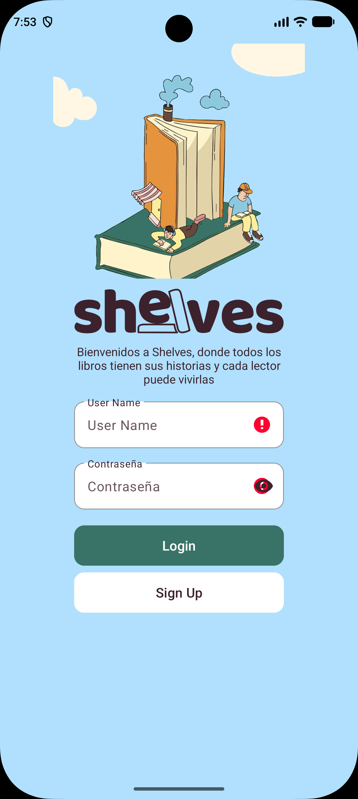
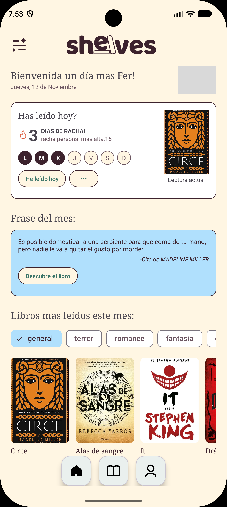
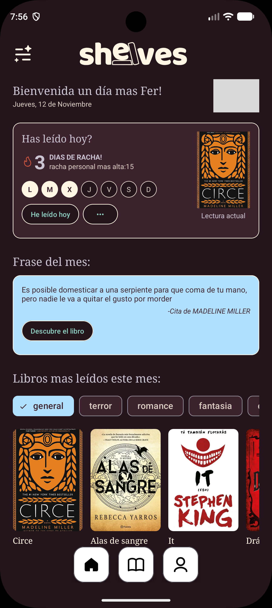
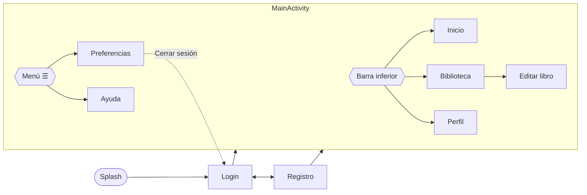
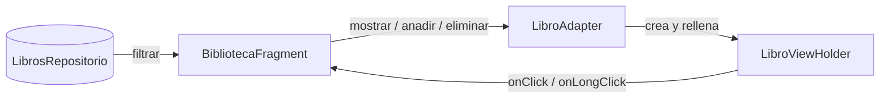

<p align="center">
  
</p>

<p align="center">
  
  
  
  
  
</p>

# Shelves 📚

**Shelves** es una aplicación Android para llevar el registro de todos los libros que lees. Es una especie de *Letterboxd*, pero para libros: puedes apuntar lo que estás leyendo, lo que ya has terminado y lo que quieres leer, valorarlo y escribir una reseña.

Tiene una parte social sencilla y sin ruido: solo te puede seguir quien conoce tu nombre de usuario, y no hay muro ni publicaciones.

## 👩‍💻 Autoras

| | |
|---|--|
| **Adriana Vallespí** | 
| **Fernanda Arias** |

Proyecto del ciclo de **Desarrollo de Aplicaciones Multiplataforma (DAM)** del Institut TIC de Barcelona.

## 📌 Estado del proyecto

| Actividad | Contenido | Estado |
|---|---|---|
| 04 | Prototipo de baja fidelidad | ✅ |
| 05 | Interfaz del prototipo en XML | ✅ |
| **06** | **Menús, navegación y listas dinámicas** | ✅ **Esta versión** |

En la Actividad 05 las pantallas eran solo diseño. En esta versión la app **ya funciona**: tiene pantalla de inicio animada, navegación entre todas las pantallas, un menú propio y dos listas dinámicas con eventos.

---

## 📱 Capturas

<table>
  <tr>
    <td align="center"><br><b>Splash</b></td>
    <td align="center"><br><b>Login</b></td>
    <td align="center"><br><b>Inicio</b></td>
    <td align="center"><br><b>Menú</b></td>
  </tr>
  <tr>
    <td align="center"><br><b>Biblioteca</b></td>
    <td align="center"><br><b>Barra de edición</b></td>
    <td align="center"><br><b>Editar libro</b></td>
    <td align="center"><br><b>Modo oscuro</b></td>
  </tr>
</table>

---

## 🧭 Navegación



La app tiene **una activity contenedora** (`MainActivity`) y casi todas las pantallas son **fragments** que se cargan dentro de ella. Solo son activities aparte el Splash, el Login y el Registro, porque se ven antes de entrar en la app.

### 🎬 Pantalla inicial (Splash)

`SplashActivity` es la primera pantalla que se abre (en el manifest es la activity `LAUNCHER`).

- El logo entra con una animación de **fundido y escala con un pequeño rebote** (`res/anim/splash_logo.xml`, con `overshoot_interpolator`).
- Cuando acaba, aparece el lema *"Tu vida lectora, en una estantería"* y, después de un momento, se abre el Login.
- Cuando se abre el Login, se llama a `finish()`, para que al pulsar "atrás" no se vuelva a ver el splash.
- Si en el móvil están **desactivadas las animaciones**, se salta la animación y se pasa directamente al Login.

### 🔐 Login y Registro

- Si un campo está vacío, se marca con un **error en rojo** en el propio campo.
- En el Registro también se comprueba que las dos contraseñas coincidan.
- Al entrar en la app se borran el Login y el Registro de la pila de pantallas, así el botón "atrás" cierra la app en vez de volver al formulario.

### ⬇️ Barra inferior

Tiene tres pestañas: **Inicio · Biblioteca · Perfil**. Al pulsar una, `MainActivity` sustituye el fragment del contenedor central (`replace`) con un fundido, y cambia el icono de la pestaña por su versión rellena (`*_active`).

### ☰ Menú hamburguesa

**No es un Navigation Drawer.** Es un fragment propio (`MenuFragment`) que aparece encima de toda la pantalla, siguiendo el diseño del prototipo:

1. Al pulsar ☰, `MainActivity` añade `MenuFragment` a `overlay_container` (un contenedor que está por encima de todo) con una animación que lo desliza desde la izquierda.
2. La transacción se guarda en el **back stack**, por eso el menú se cierra tanto con su botón como con el "atrás" del móvil.
3. Desde el menú se puede:
    - Abrir **Preferencias** o **Ayuda**. Se cierra el menú y la sección se abre en el contenedor central; con "atrás" se vuelve a la pestaña en la que estabas.
    - Cambiar entre **modo claro y oscuro**.
    - Pulsar los enlaces de **contacto** (Instagram, Threads y email). De momento solo muestran un aviso.

**Funciones de `MainActivity` que controlan la navegación:**

| Función | Qué hace |
|---|---|
| `navegarA(boton, fragment)` | Cambia de pestaña y marca el icono activo |
| `abrirMenu()` / `cerrarMenu()` | Muestra u oculta el menú con su animación |
| `abrirSeccion(fragment)` | Cierra el menú y abre Preferencias, Ayuda o Editar libro, guardándolo en el back stack |
| `mostrarBarraNavegacion(visible)` | Oculta la barra inferior mientras se ve la barra de edición de la Biblioteca |

---

## 📋 Listas dinámicas (RecyclerView)

La app tiene **dos listas dinámicas** con su propio diseño de fila.

### 1. Biblioteca (lista vertical)



| Clase | Para qué sirve |
|---|---|
| `Libro` | `data class` con los datos de un libro: título, autor, páginas, lista, valoración, reseña y portada. El porcentaje leído se calcula a partir de las páginas |
| `ListaLibro` | `enum` con las tres listas: *Leyendo*, *Leídos* y *Quiero leer* |
| `LibrosRepositorio` | `object` con los libros de prueba. Al ser un `object`, toda la app comparte los mismos datos |
| `LibroViewHolder` | Guarda las vistas de una fila (`item_libro.xml`), para no buscarlas cada vez que se reutiliza al hacer scroll. Su función `bind()` pone los datos del libro y le asigna los eventos |
| `LibroAdapter` | Conecta la lista de libros con el RecyclerView: `onCreateViewHolder` crea las filas, `onBindViewHolder` las rellena y `getItemCount` dice cuántas hay. Los clics no se programan aquí, se reciben como funciones (*lambdas*), así la lógica queda en el fragment |

**Eventos de la lista:**

| Gesto | Evento | Qué pasa |
|---|---|---|
| Tocar un libro | ✏️ **Modificar** | Se abre *Editar libro* (página actual, valoración, reseña y lista). Al guardar, el libro se actualiza |
| Mantener pulsado | Seleccionar | El libro se marca con un borde verde y la barra inferior se cambia por la **barra de edición** |
| ➕ en la barra | **Añadir** | Diálogo con título, autor y páginas. El libro aparece al final con animación (`notifyItemInserted`) |
| ↔️ en la barra | **Modificar** (mover) | Diálogo para cambiar de lista. El libro desaparece de la lista actual (`notifyItemRemoved`) |
| 🗑️ en la barra | **Eliminar** | Se pide confirmación y se borra el libro (`notifyItemRemoved`) |

Todos los eventos escriben un **Log** (con el tag `Biblioteca`) y muestran un **Toast**. Además, la lista se puede filtrar con los **chips** de cada lista y con el **buscador** (por título o autor).

### 2. Libros más leídos del mes (lista horizontal, en Inicio)

Es un carrusel de portadas que se filtra por género con los chips (*General, Terror, Romance, Fantasía, Distopía*). Al tocar una portada sale un Toast con el título y el autor.

| Clase | Para qué sirve |
|---|---|
| `LibroTop` / `Genero` | Modelo de cada libro del ranking y sus géneros |
| `TopLibros` | `object` con los datos de prueba y la función `porGenero()` |
| `PortadaViewHolder` | Guarda la portada y el título de `item_portada.xml` |
| `PortadaAdapter` | Rellena el carrusel y cambia los libros al elegir otro género |

---

## ♿ Accesibilidad y usabilidad

### Nuevo en la Actividad 06

| Acción | Por qué |
|---|---|
| El splash se salta la animación si están desactivadas en el sistema | Hay personas a las que el movimiento les molesta o marea |
| Botón de menú ampliado de 32dp a **48dp** de zona táctil (el icono se sigue viendo igual) | Es el tamaño mínimo recomendado para poder tocarlo bien |
| La pestaña activa se marca con `isSelected` | TalkBack dice "seleccionado" en la pestaña actual |
| Cada fila de la lista tiene una sola descripción: *"Circe, de Madeline Miller. Leído un 34%"* | TalkBack lee la fila entera de una vez, en vez de cada texto por separado |
| Los gestos de las filas tienen nombre para TalkBack: *"Editar"* y *"Seleccionar"* | El usuario sabe qué pasará antes de tocar |
| El libro seleccionado se marca con un **borde más grueso**, no solo con otro color | Se distingue aunque no se vean bien los colores |
| El botón "atrás" cierra primero el menú y quita la selección | Se comporta como el usuario espera |
| **Confirmación** antes de eliminar un libro | Evita borrar por error |
| Errores de los formularios en el propio campo | Se ve enseguida qué falta |
| `contentDescription` en las tarjetas clicables del menú, e iconos decorativos con `importantForAccessibility="no"` | Que TalkBack no lea dos veces lo mismo |
| Inspect Code sin avisos de accesibilidad | Revisión final |

### De la Actividad 05

- Zonas táctiles de **48dp como mínimo** en botones y controles.
- `contentDescription` en todos los elementos interactivos.
- Títulos marcados como **encabezados** (`accessibilityHeading`).
- Colores de texto con **contraste suficiente**, también en modo oscuro.
- Teclados adecuados según el campo (numérico, texto multilínea…).

---

## 🎨 Diseño

### Prototipo en Figma

El diseño visual de la app es de **Adriana Vallespí**, que lo hizo en Figma a partir del prototipo de baja fidelidad de la Actividad 04.

🎨 **[Ver el diseño de Shelves en Figma](https://www.figma.com/design/OnKBkMrcMR1xTcMjwMCeNa/shelves?node-id=0-1&p=f)**

### Paleta

| | Color | Uso |
|---|---|---|
|  | **Midnight violet** `#3C222D` | Texto y bordes |
|  | **Verde** `#397367` | Color principal: botones, progreso y selección |
|  | **Icy blue** `#B0E0FD` | Acentos y fondo del menú |
|  | **Crema** `#FFF6E3` | Fondo |

### Recursos

- **Tema propio** basado en Material 3 (`Theme.Shelves`), con **modo claro y oscuro** (`values/colors.xml` y `values-night/colors.xml`).
- **Estilos reutilizables** en `styles.xml`: tarjetas con borde, botones, campos de texto y títulos en serif.
- **Animaciones** en `res/anim`: entrada del splash, y entrada y salida del menú.
- **Drawables** propios: iconos vectoriales, logo y portadas de los libros de prueba.
- **Textos** separados en un archivo de strings por pantalla.

---

## 🗂️ Estructura del código

```
app/src/main/java/com/shelves/app/
├── SplashActivity.kt        Pantalla inicial animada
├── LoginActivity.kt         Inicio de sesión
├── RegistreActivity.kt      Registro
├── MainActivity.kt          Contenedor: barra inferior + menú + fragments
├── MenuFragment.kt          Menú hamburguesa
├── HomeFragment.kt          Inicio (carrusel de más leídos)
├── BibliotecaFragment.kt    Biblioteca (lista, selección y diálogos)
├── EditarLibroFragment.kt   Editar un libro
├── PerfilFragment.kt        Perfil
├── PreferenciasFragment.kt  Preferencias
├── AyudaFragment.kt         Ayuda
├── Libro.kt                 Modelo: Libro + ListaLibro
├── LibrosRepositorio.kt     Datos de prueba de la Biblioteca
├── LibroAdapter.kt          Adapter de la Biblioteca
├── LibroViewHolder.kt       Holder de la Biblioteca
├── TopLibros.kt             Modelo y datos del carrusel
├── PortadaAdapter.kt        Adapter del carrusel
└── PortadaViewHolder.kt     Holder del carrusel
```

Las clases y funciones principales están documentadas con comentarios **KDoc** (el equivalente de JavaDoc en Kotlin).

---

## 🚀 Cómo abrir el proyecto

1. Clonar el repositorio:
   ```bash
   git clone https://github.com/Ferarias-04/Shelves.git
   ```
2. Abrir la carpeta `Shelves` en **Android Studio** y esperar a que sincronice Gradle.
3. Ejecutar la app (▶) en un emulador o en un móvil.
4. Se puede entrar con **cualquier usuario y contraseña**, porque todavía no hay usuarios reales.

**Requisitos:** Android Studio reciente · `minSdk` 24 (Android 7.0) · Kotlin.